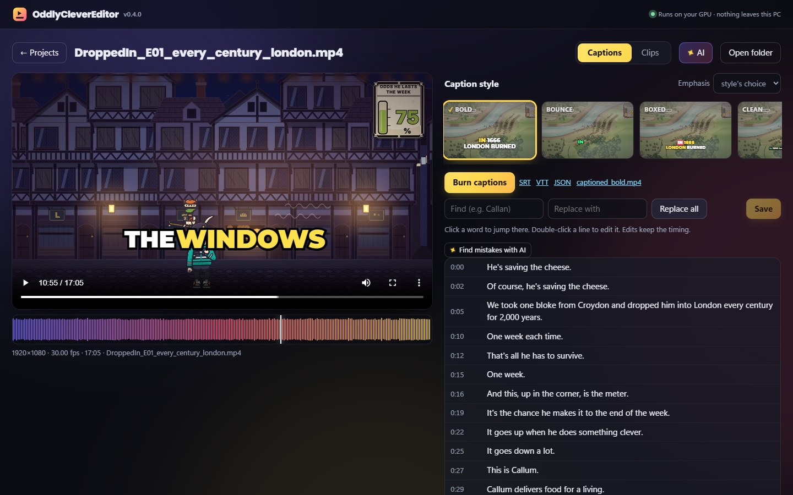
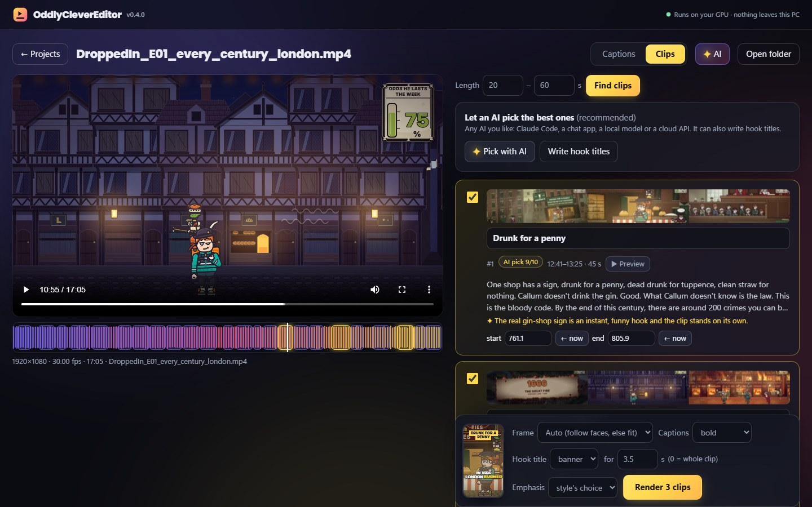
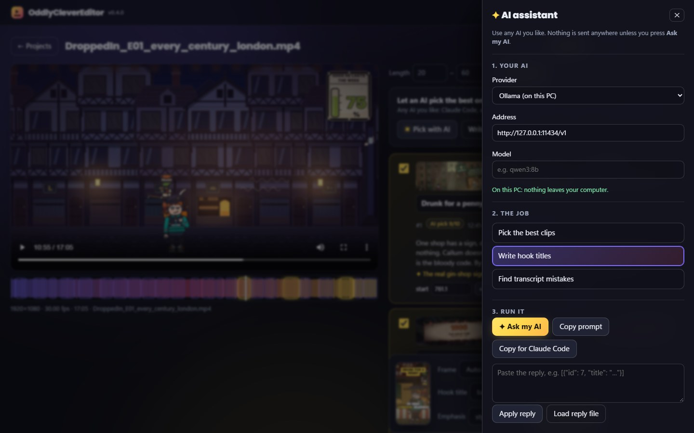
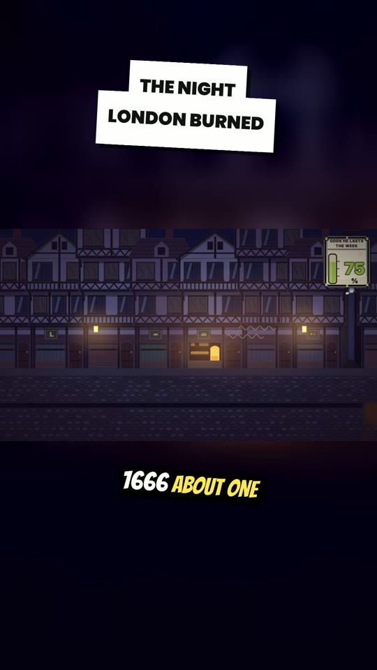

# OddlyCleverEditor

Free, local captions and Shorts for video creators. It runs on your own NVIDIA GPU, keeps your video offline, and has no subscription, credits or watermark.

[](https://ko-fi.com/oddlyclevertools)

It's free forever. If it saves you time, you can buy me a tea.

```
oddlyclever caption my_video.mp4 --style bold
```

You get:

- `my_video.json`: the word-timed transcript. You can edit it to fix a word, then re-burn.
- `my_video.srt` and `my_video.vtt`: subtitles to upload to YouTube, TikTok, Facebook, Rumble and others.
- `my_video_bold.mp4`: the video with styled captions burned in. The spoken word is highlighted.
- `my_video_bold.ass`: the styled caption file, which opens in Aegisub, mpv or VLC.

It also finds the best short clips in a long video and exports them as vertical 9:16 Shorts with captions:

```
oddlyclever clips my_video.mp4 --count 5
```

See [Short clips](#short-clips-916) below.

Or do it all in the browser:

```
oddlyclever ui
```



| Clips: scored candidates, filmstrips and the render bar | Any AI you like |
| --- | --- |
|  |  |

<p align="center"></p>

## Install with the Windows installer

Run `OddlyCleverEditor-setup-0.4.0.exe`. From GitHub Releases, download it **and** its `.bin` parts into one folder first (GitHub caps each file at 2 GiB). It's a full offline installer (about 3 GB), with no admin rights needed. It contains:

- a private Python;
- every package;
- ffmpeg;
- the Whisper model.

Nothing is downloaded during install or on first run. It installs to `%LOCALAPPDATA%\Programs\OddlyCleverEditor`, adds a Start menu (and optional desktop) shortcut, and checks for an NVIDIA driver first. The shortcut opens a small console window and the app in your browser; close the window to stop cliptool. Uninstalling removes the app and keeps your projects (`~/cliptool-projects`). Windows SmartScreen may say "unknown publisher", because the build isn't code-signed yet.

The same `oddlyclever.cmd` in the install folder runs the command line too, for example `oddlyclever.cmd clips video.mp4`. To build the installer yourself, see `installer/build.py`.

## Browser UI

`oddlyclever ui` starts a small local server on `http://127.0.0.1:8765` and opens it in your browser. It's the same engine as the CLI, and the video never leaves your PC.

- **Add a video.** Drop it on the page (it's copied into the workspace, `~/OddlyCleverEditor-projects` by default, or `~/cliptool-projects` if you used an early build), or paste its path to use it where it is, with no copy.
- **Captions tab:**
  - **Transcribe** on the GPU, with optional name hints and fixes (`Callan=Callum`).
  - **Edit the transcript.** Click a word to jump the video there. Double-click a line to edit it and press Enter: the words keep their timing, or are re-spread if you add or remove words. Words Whisper wasn't sure about are underlined.
  - **Find and replace** whole words across the transcript.
  - **Style gallery:** every caption style plays as a small animated card over a frame of your video. Pick one and the player shows it live, drawn from the same line breaks and word timing the burn uses. **Emphasis** colours numbers and names (the style's choice, on or off).
  - **Burn captions** with a progress bar, then download the MP4, SRT, VTT or JSON.
- **Clips tab:**
  - **Find clips** gives the scored candidates, with the top 5 ticked.
  - **✦ Pick with AI** and **Write hook titles** open the AI panel (below).
  - Review each clip: **▶ Preview** plays exactly that span. You can edit the title and nudge the start and end ("← now" takes the player's position); times snap to sentence boundaries.
  - Each clip card has a GPU-decoded filmstrip. The **timeline** under the player shows the whole video's waveform, with every candidate as a span (picked ones glow); click it to seek.
  - **Render** to 9:16 (auto, crop or fit), with any caption style and an animated **hook title** (banner, sticker, outline or none, for 3.5 s or the whole clip). A small phone mock-up previews the look. The Shorts appear in the page as vertical players that play on hover, with download links. **Open folder** shows them in Explorer.
- Jobs run one at a time on the GPU. The top bar shows progress, time left and how many are queued, and has a **Cancel** button that stops ffmpeg and removes the half-written file. A reload picks a running job back up.
- Your AI picks and every rendered Short stay listed per project after a reload. Leaving a project with unsaved transcript edits asks first.

### The AI panel (any AI you like)

The **✦ AI** button opens a side panel. No model ships with OddlyCleverEditor: you choose one, and nothing is sent anywhere unless you press **Ask my AI**.

- **Three jobs:**
  - **Pick the best clips** from the candidates (and tighten their start and end);
  - **Write hook titles** for the ticked clips;
  - **Find transcript mistakes:** misheard names and sound-alike words. Each fix is shown with its reason and how many times it occurs, and you apply them one by one or all at once. Only single words that really occur in the transcript are accepted.
- **Three ways to run a job:**
  - **Ask my AI** sends it to any OpenAI-compatible `/chat/completions` server. The provider list fills in the address for Ollama, LM Studio and llama.cpp (on this PC), and for Anthropic, OpenAI, Google Gemini, OpenRouter, Groq, Mistral and DeepSeek, or type any other. Type the model name your provider lists.
  - **Copy prompt** for any chat app, then paste its reply and press **Apply reply**.
  - **Copy for Claude Code** gives a one-line instruction for Claude Code (or any agent): it reads the prompt from the project folder (`judge.md`, `ai_titles.md` or `ai_fixes.md`) and saves its JSON reply next to it. Then press **Load reply file**.
- **Your key.** A cloud provider needs an API key. The panel keeps it in the page's memory only: it's never written to disk or browser storage, and a reload clears it. It's only sent over HTTPS (or to a server on this PC), and redirects are never followed. The address, provider and model are remembered.
- **Privacy.** The panel says whether the address is on this PC or in the cloud, and **Ask my AI** asks before sending the transcript text off your PC.
- AI jobs share the GPU job queue, so a slow AI holds the queue until it answers (or times out after 10 minutes). **Cancel** stops waiting at once.

**Safety.** The server only listens on 127.0.0.1. Every API call needs a random token made fresh each run, the Host header must be localhost (this blocks DNS-rebinding attacks), and cross-site requests (by `Origin` or `Sec-Fetch-Site`) are refused. The page has a strict Content-Security-Policy, `nosniff` and `no-referrer`, and only the built-in caption styles are accepted. Files are only served from a project's own folder or its source video. Options: `--port`, `--workspace DIR`, `--no-browser`.

## Speed on a laptop RTX 5050 (8 GB)

A test on a real 17 min 05 s, 1080p narrated episode (*Dropped In* E01), 27 Oct 2026:

| Step | Time | Speed | Hardware used |
|---|---|---|---|
| Transcribe (Whisper large-v3-turbo, float16) | 32 s | ~32× real time | GPU: CUDA, peak 2.3 GB VRAM |
| Burn the `bold` captions, full length | 98 s | ~10.5× real time | GPU: NVDEC decode, NVENC encode at ~95%. libass draws the text on the CPU (light work) |
| 30 s `--preview` of a style | ~3–4 s | | |
| Find clips and render 5 vertical Shorts (200 s of video in total) | 33 s | ~5–8 s per clip | GPU: NVDEC, `scale_cuda`, `overlay_cuda`, NVENC. Face detection runs on small frames at 4 Hz (light CPU work) |

The first run downloads the Whisper model once (~1.6 GB). After that, everything works with no internet.

## Install (Windows)

You need:

- an NVIDIA GPU with a current driver;
- Python 3.10 or newer;
- ffmpeg on your PATH: `winget install Gyan.FFmpeg`.

```bash
cd OddlyCleverEditor
python -m venv .venv
.venv\Scripts\pip install -e .
.venv\Scripts\oddlyclever --version
```

This installs faster-whisper and NVIDIA's cuBLAS runtime from pip. You don't need to install the CUDA toolkit.

The command is `oddlyclever`; the older name `cliptool` works too. Inside the code the Python package is still called `cliptool`, and so are its settings (`CLIPTOOL_JUDGE_KEY`, `CLIPTOOL_MODELS_DIR`).

## Use

```bash
oddlyclever caption video.mp4                      # transcribe + SRT/VTT + bold burned-in captions
oddlyclever caption video.mp4 --style clean        # another style (reuses the transcript, no re-transcribe)
oddlyclever caption video.mp4 --preview 30         # render only the first 30 s to check the look
oddlyclever transcribe video.mp4 --prompt "Iceni, Boudica, Londinium"   # help Whisper spell names
oddlyclever burn video.mp4 --style minimal         # burn again from the (edited) JSON
oddlyclever styles                                 # list the styles
oddlyclever clips video.mp4 --count 5              # find and export 5 vertical Shorts
oddlyclever ui                                     # the browser UI
```

Useful options:

- `--language en` skips language detection.
- `--out-dir DIR` writes the outputs somewhere else.
- `--encoder hevc_nvenc` gives smaller files.
- `--quality 23` also gives smaller files (lower is better; the default is 19).
- `--retranscribe` ignores an existing transcript.
- `--replace Callan=Callum` fixes a recurring wrong word everywhere in the transcript, keeping its punctuation (`Callan's` becomes `Callum's`). You can repeat it.
- `--prompt "Name, Place"` helps Whisper spell names in the first 30 s. `--hotwords` does the same for the whole video. In testing it once dropped 9 s of speech, though, so check the result, or use `--replace` instead.

### Fixing a word

Open `video.json`, change the `"text"` of the wrong word (leave the times alone), save it, then run `oddlyclever burn video.mp4`. `caption` re-reads the JSON too, so the SRT/VTT get the fix as well.

## Caption styles

| Style | Look | Good for |
|---|---|---|
| `bold` | 1–3 big uppercase words (Montserrat Black), white with a black outline. The spoken word turns yellow and pops | Shorts, Reels, TikTok |
| `clean` | One sentence on a soft dark box (Montserrat SemiBold). The spoken word is tinted blue | Long-form, talking heads |
| `minimal` | Classic two-line subtitles, thin outline, no highlight | Accessibility, documentaries |
| `karaoke` | A yellow fill sweeps through each word as it's spoken | Music, punchy narration |
| `boxed` | The spoken word sits on a red box that jumps from word to word (Poppins Black) | Shorts |
| `bounce` | Words spring in one by one as they're spoken, the newest in green (Archivo Black) | Fast talkers |
| `neon` | Tall Bebas Neue letters with a cyan glow; the spoken word glows pink | Night, gaming, tech |
| `comic` | Tilted yellow Bangers letters that punch in word by word | Comedy, animation |
| `typewriter` | Letters type out on a dark box as each word is spoken | Stories, quotes |
| `marker` | Hand-drawn Permanent Marker letters; the spoken word turns orange | Vlogs, casual |

Every new style also colours **emphasis words** (numbers, money, years and names) with an accent. Use `--emphasis on|off` to force it either way on any style.

A style is a small JSON file in `cliptool/presets/`. To make your own, copy one, change the font, sizes, colours (`#RRGGBB` or `#RRGGBBAA`), position or words per line, and pass its path: `--style my_style.json`. The fields for effects are:

- `effect`: `highlight`, `karaoke`, `boxed`, `bounce` or `typewriter`;
- `reveal`;
- `tilt`, in degrees;
- `glow` and `glow_color`;
- `accent`;
- `active_color`. Sizes are fractions of the frame, so one style works for 16:9 and 9:16. Fonts come from `cliptool/fonts/`: drop any `.ttf` in there and use its name.

## Short clips (9:16)

```bash
oddlyclever clips video.mp4 --count 5              # heuristic picks, rendered to video_clips/
oddlyclever clips video.mp4 --judge                # write a prompt so an LLM can rank the candidates
oddlyclever clips video.mp4 --ranking video.ranking.json   # render the judge's picks
oddlyclever clips video.mp4 --layout fit --min 15 --max 45 --no-render
oddlyclever clips video.mp4 --judge-url http://127.0.0.1:11434/v1 --judge-model qwen3:8b   # your own AI server judges
oddlyclever clips video.mp4 --title-look sticker --title-secs 0 --style comic             # hook title for the whole clip
```

1. **Candidates.** Every run of whole sentences between `--min` and `--max` seconds (default 20–60) is scored. The score looks at:
   - the hook in the first sentence: a question, a number, "you", strong words;
   - whether it starts mid-thought ("And he…" is penalised);
   - clean pauses at both cut points;
   - pace and loudness.

   The best 24 non-overlapping windows go to `video.candidates.json`.
2. **Judge (optional, recommended).** `--judge` writes `video.judge.md`, a ready prompt that lists every candidate with sentence timestamps. Give it to any LLM, for example by asking Claude Code to follow it. Save the JSON reply as `video.ranking.json` and run again with `--ranking`. The judge can tighten a clip's start or end, and the tool snaps those to sentence boundaries, drops overlaps and checks the ids. The heuristic alone is fine but can't tell what's *interesting*; the judge can.

   Instead of passing files around, `--judge-url` sends the same prompt to any OpenAI-compatible server you run (`/chat/completions`), and the reply goes straight into the render. If it needs a key, set `CLIPTOOL_JUDGE_KEY`; the key is never saved. A server that isn't on this PC gets a warning, because the transcript text goes there.
3. **Reframe.** The tool tracks the main face shot by shot:
   - it detects cuts, so the camera jumps on a cut and never slides across one;
   - inside a shot, the camera holds still in a dead zone and eases toward the face, with a speed cap;
   - shots with no face are centred.

   Layouts:
   - `--layout auto` (the default) crops when a face is tracked through at least half the clip, and otherwise uses `fit`;
   - `fit` puts the whole frame across the width over a blurred fill of itself;
   - `crop` and `fit` force one or the other;
   - vertical sources are only cut.
4. **Render.** Each clip is cut, reframed and captioned (the `--style` default is `bold`), with short audio fades. The clip's title becomes an animated hook title at the top (`--title-look banner|sticker|outline|none`, default `banner`; `--title-secs`, default 3.5, where 0 means the whole clip). It goes to `video_clips/NN_title.mp4`, plus a `clips.json` manifest with titles, reasons and times.

**On animation and graphics-heavy videos, use `fit`.** Cropping 16:9 to 9:16 keeps about a third of the width, so on-screen text and counters near the edges get cut. On *Dropped In* E01 the crop followed the characters well, but it clipped some title cards.

## How it works

1. ffmpeg decodes the audio to 16 kHz mono.
2. faster-whisper (CTranslate2) runs Whisper large-v3-turbo on the GPU with word timestamps. Silero VAD skips the silences.
3. The chunker groups the words into on-screen lines:
   - it breaks at sentence ends and pauses;
   - it doesn't leave "and/the/of" dangling at a line end;
   - it glues Whisper's split tokens like `2` + `,000` back together.
4. The lines are written as SRT/VTT, and as an ASS file with one event per spoken word for the highlight.
5. ffmpeg burns the ASS with libass. Decoding uses NVDEC and encoding uses NVENC (`h264_nvenc`, CQ 19). The output is written to a temp name and renamed only when it's complete.

## Tests

```bash
.venv\Scripts\pip install -e .[dev]
.venv\Scripts\python -m pytest -q
```

The tests cover:

- chunking, and SRT/VTT/ASS output;
- every caption style and effect, emphasis words and hook titles;
- that each bundled font has its licence;
- transcript files and fixes, and portrait line fitting;
- clip scoring, judge-ranking validation and the bring-your-own judge (against a fake OpenAI-compatible server, including the key policy and redirects);
- the AI hook-title and transcript-fix jobs, and that a key typed in the UI is never written to disk;
- the camera path. The UI server is tested for:

- token, Host and Origin checks;
- byte ranges and path traversal;
- upload and editing;
- cancel and duplicate jobs;
- the waveform and frame strips;
- the AI prompt and reply files on disk;
- render-option validation.

On an NVIDIA GPU the tests also burn every style for real, render 9:16 crop and fit clips from generated video, and check the pixels are square.

## Roadmap

- **Done in 0.2:** the clip finder, the LLM-judge files, and 9:16 reframing (face crop or blurred fit).
- **Done in 0.3:** the local browser UI.
- **Done in 0.4:**
  - seven new caption styles, emphasis words and animated hook titles;
  - an animated UI with a style gallery, timeline, filmstrips and phone preview;
  - an AI panel for any AI you like: pick clips, write hook titles, find transcript mistakes;
  - the full offline Windows installer.
- **Later:**
  - split screen for two speakers;
  - keeping on-screen text in frame (text detection);
  - a per-shot choice between crop and fit.

## Licence

MIT: use it for anything, paid work included. See `LICENSE`. Versions up to 0.4.0 were released under GPL-3.0. The name, logo and characters aren't covered by the licence: see [TRADEMARKS.md](TRADEMARKS.md). The bundled fonts are SIL OFL 1.1 (Permanent Marker is Apache-2.0). The Whisper weights and the bundled YuNet face model are MIT. Full list and notes: [THIRD_PARTY.md](THIRD_PARTY.md).

Not affiliated with Descript, Opus Clip, Submagic or OpenAI.
